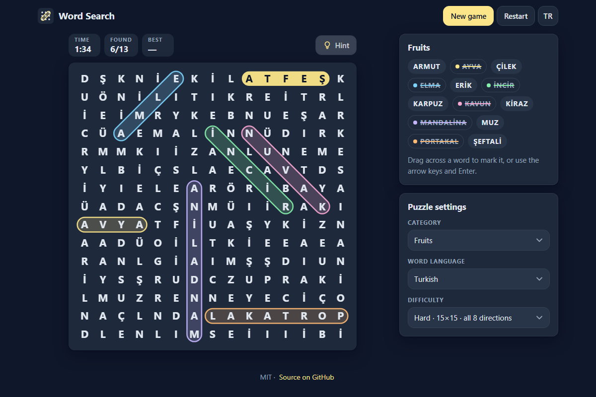

# Word Search - find hidden words in English and Turkish, on your phone or desktop

[](#tests)
[](LICENSE)

**▶ Play now: https://celaldrg.github.io/word-search/**



A classic word search that runs in the browser: no install, no sign-up, no ads and no tracking.
Pick a category, drag across the hidden words and beat your own best time. Plain HTML, CSS and
JavaScript modules, with no build step and no dependencies.

## Features

- **20 categories** (animals, fruits, space, jobs, feelings and more), each with 15 words in
  **English** and in **Turkish**. Turkish puzzles use the 29-letter Turkish alphabet
  (with Ç, Ğ, İ, Ö, Ş, Ü) and Turkish upper-casing (i → İ, ı → I).
- **Three difficulties**: Easy 10×10 (→ ↓), Medium 12×12 (→ ↓ ↘ ↗) and Hard 15×15
  (all 8 directions, so backwards too).
- **Fair puzzles**: every word is hidden exactly once. The filler letters never spell a second
  copy, forwards or backwards.
- **Mouse, touch and keyboard**: the selection snaps to straight lines, so a shaky finger still
  lands on the word.
- **Hints** flash the first letter of a word you have not found yet; the win screen shows how
  many you used.
- **Timer and best times** for each word language and difficulty, kept in your browser.
- **English and Turkish interface** (the TR / EN button), remembered on your next visit.
- **Restart** replays the same puzzle; **New game** deals a fresh one.
- Dark theme, mobile first (from 375 px wide), and it respects the "reduce motion" setting.

## How to play

Find every word in the list. A found word is struck through in the list and circled on the board
in its own color.

**Touch or mouse:** press on the first letter of a word, drag to its last letter and let go.
Selecting a word from its last letter back to its first works too.

**Keyboard:** click the board or Tab to it, then:

| Key | Action |
| --- | --- |
| Arrow keys | Move the cursor |
| Enter or Space | Start a selection on the first letter, end it on the last letter |
| Escape | Cancel the selection |

**Hint** shows where an unfound word starts. Category, word language and difficulty are under
**Puzzle settings**; changing one starts a new game.

## Run locally

ES modules do not load from `file://`, so open the game over `http://` instead of
double-clicking `index.html`:

```sh
git clone https://github.com/celaldrg/word-search.git
cd word-search
npx serve .
```

Then open the address it prints (usually http://localhost:3000). Any static file server works.
Add `?demo` to the address for the half-solved puzzle used in the screenshot.

## Tests

```sh
node --test
```

Node 20 or newer, nothing to install. The tests cover the seeded random numbers, the alphabets
and Turkish upper-casing, the word lists, the puzzle generator (directions per difficulty,
every grid size, crossings, filler letters, every word exactly once, same seed same puzzle),
straight-line selection and snapping, a whole round (pointer and keyboard selection, hints,
timer, winning, the demo), best times, the storage wrapper, the translation tables (same keys
and placeholders in both languages, every key the page uses exists) and the board geometry,
letter size and colors. GitHub Actions runs them on every push and pull request.

## Project structure

```
index.html          page markup; every text is marked for translation
style.css           dark theme, mobile-first layout
src/
  main.js           entry point: input, animation loop, saving
  board.js          canvas drawing of the grid
  view.js           word list, settings and win dialog
  game.js           one round: selection, hints, timer, win, demo
  generator.js      puzzle generator
  selection.js      straight-line selection
  words.js          20 categories in English and Turkish
  text.js           alphabets and Turkish-aware upper-casing
  i18n.js           interface strings (EN / TR)
  layout.js effects.js palette.js records.js rng.js storage.js
test/               node:test unit tests
docs/screenshot.png
```

## License

[MIT](LICENSE) © 2026 Celalettin Durgaç

## Türkçe

**▶ Hemen oyna: https://celaldrg.github.io/word-search/**

Tarayıcıda çalışan klasik bir kelime avı bulmacası: kurulum, üyelik, reklam ve izleme yok.
Bir kategori seç, gizli kelimelerin üzerinde sürükle ve kendi rekorunu kır. Derleme adımı ve
bağımlılığı olmayan düz HTML, CSS ve JavaScript modülleriyle yazıldı.

### Özellikler

- **20 kategori** (hayvanlar, meyveler, uzay, meslekler, duygular ve dahası); her birinde
  **Türkçe** ve **İngilizce** 15'er kelime. Türkçe bulmacalar 29 harfli Türk alfabesini
  (Ç, Ğ, İ, Ö, Ş, Ü dahil) ve Türkçe büyük harf kurallarını (i → İ, ı → I) kullanır.
- **Üç zorluk**: Kolay 10×10 (→ ↓), Orta 12×12 (→ ↓ ↘ ↗) ve Zor 15×15 (8 yönün hepsi,
  yani tersten de).
- **Adil bulmacalar**: her kelime tabloda tam bir kez geçer. Dolgu harfleri ne düz ne ters
  ikinci bir kopya oluşturur.
- **Fare, dokunmatik ve klavye**: seçim düz çizgilere oturur, parmak biraz kaysa da kelime
  tutturulur.
- **İpucu**, henüz bulunmamış bir kelimenin ilk harfini yanıp söndürür; kazanınca kaç ipucu
  kullandığın gösterilir.
- **Süre ve rekorlar**: her kelime dili ve zorluk için ayrı tutulur, tarayıcında saklanır.
- **Türkçe ve İngilizce arayüz** (TR / EN düğmesi), bir sonraki ziyarette hatırlanır.
- **Baştan** aynı bulmacayı yeniden başlatır; **Yeni oyun** yeni bir bulmaca kurar.
- Koyu tema, önce mobil (375 px genişlikten itibaren); "hareketi azalt" ayarına uyar.

### Nasıl oynanır

Listedeki bütün kelimeleri bul. Bulunan kelimenin listede üstü çizilir, tabloda da kendi rengiyle
işaretlenir.

**Dokunmatik ya da fare:** kelimenin ilk harfine bas, son harfine kadar sürükle ve bırak.
Kelimeyi son harfinden ilk harfine doğru seçmek de olur.

**Klavye:** tabloya tıkla ya da Tab ile gel, sonra:

| Tuş | İşlev |
| --- | --- |
| Ok tuşları | İmleci taşır |
| Enter ya da Boşluk | İlk harfte seçimi başlatır, son harfte bitirir |
| Escape | Seçimi iptal eder |

**İpucu** bulunmamış bir kelimenin nereden başladığını gösterir. Kategori, kelime dili ve zorluk
**Bulmaca ayarları** kartındadır; birini değiştirmek yeni oyun başlatır.

### Yerelde çalıştırma

ES modülleri `file://` üzerinden yüklenmez. `index.html` dosyasını çift tıklayarak açma, oyunu
`http://` üzerinden aç:

```sh
git clone https://github.com/celaldrg/word-search.git
cd word-search
npx serve .
```

Sonra yazdığı adresi aç (genelde http://localhost:3000). Herhangi bir statik dosya sunucusu da
olur. Adresin sonuna `?demo` eklersen ekran görüntüsündeki yarısı çözülmüş bulmaca açılır.

### Testler

```sh
node --test
```

Node 20 ya da üstü yeter, kurulacak bir şey yok. Testler tohumlu rastgele sayıları, alfabeleri
ve Türkçe büyük harf dönüşümünü, kelime listelerini, bulmaca üreticisini (zorluğa göre yönler,
her tablo boyutu, kesişmeler, dolgu harfleri, her kelimenin tek kez geçmesi, aynı tohumla aynı
bulmaca), düz çizgi seçimini, bir turun tamamını (fare ve klavye seçimi, ipucu, süre, kazanma,
demo), rekorları, depolama sarmalayıcısını, çeviri tablolarını ve tablonun geometrisini, harf
boyutunu ve renklerini kapsar. GitHub Actions her push ve pull request'te testleri çalıştırır.

### Proje yapısı

```
index.html          sayfa iskeleti; her metin çeviri için işaretli
style.css           koyu tema, önce mobil yerleşim
src/
  main.js           giriş noktası: girdi, animasyon döngüsü, kayıt
  board.js          tablonun canvas çizimi
  view.js           kelime listesi, ayarlar ve kazanma penceresi
  game.js           bir tur: seçim, ipucu, süre, kazanma, demo
  generator.js      bulmaca üreticisi
  selection.js      düz çizgi seçimi
  words.js          Türkçe ve İngilizce 20 kategori
  text.js           alfabeler ve Türkçeye uygun büyük harf dönüşümü
  i18n.js           arayüz metinleri (EN / TR)
  layout.js effects.js palette.js records.js rng.js storage.js
test/               node:test birim testleri
docs/screenshot.png
```

### Lisans

[MIT](LICENSE) © 2026 Celalettin Durgaç
